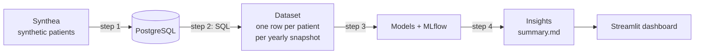
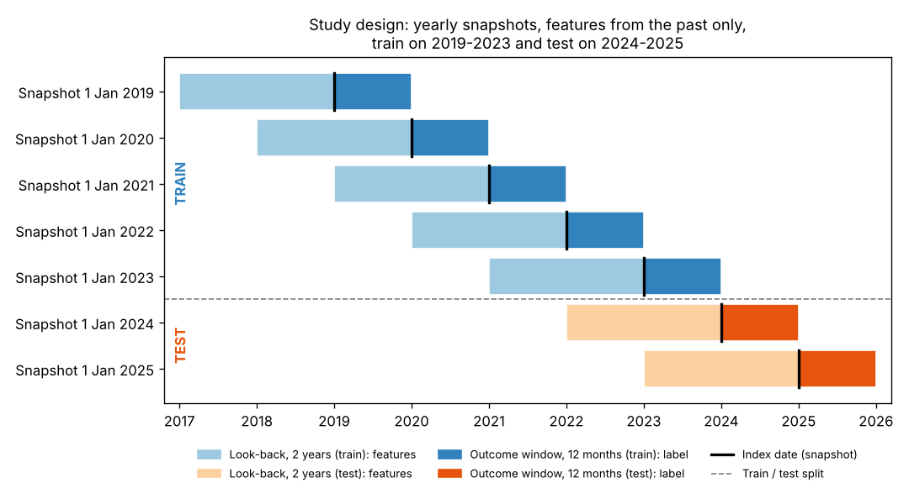
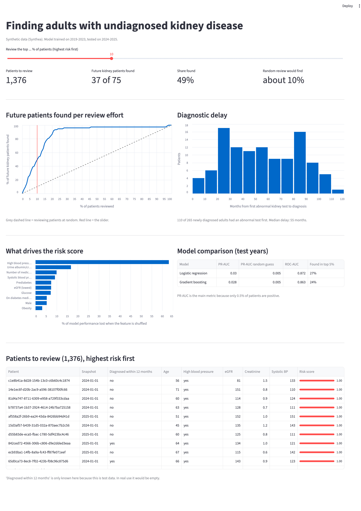
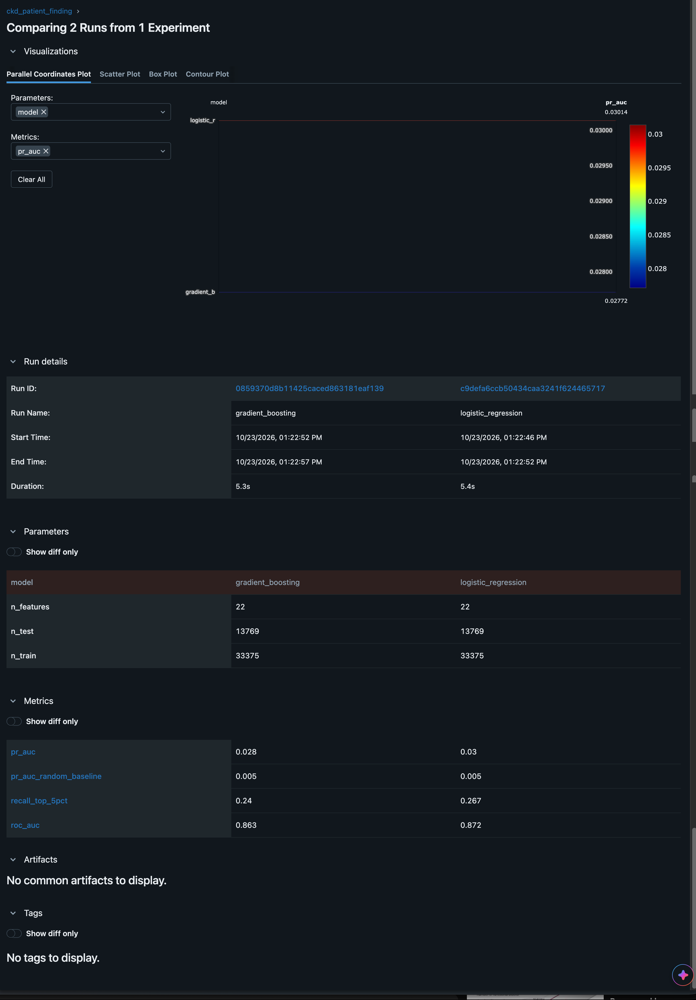

# Patient finding: flagging undiagnosed kidney disease

Can routine health records flag adults who will be **diagnosed with chronic kidney disease in the next
12 months**, so they can be tested and treated earlier?

The data is synthetic, made with [Synthea](https://github.com/synthetichealth/synthea), so no real patients
are involved. It has the same structure as real health records: patients, visits, diagnoses, lab results and medicines.

## How it works



| Step | File | What it does |
|---|---|---|
| 1 | `step1_load_data.py` | Loads the Synthea CSV files into PostgreSQL |
| 2 | `step2_build_dataset.py` | Runs `sql/2_cohort.sql` and `sql/3_features.sql` |
| 3 | `step3_train_model.py` | Logistic regression vs gradient boosting, PR-AUC, MLflow |
| 4 | `step4_insights.py` | Diagnostic delay, cases found per review effort, `reports/summary.md` |
| - | `run_all.py` | Steps 1-4 in order |
| - | `app.py` | Streamlit dashboard |
| - | `notebooks/explore.ipynb` | First look at the data |
| - | `tests/test_no_leakage.py` | Checks that no future information leaks into the features |

## The set-up



- **Snapshot:** on 1 January of every year 2019-2025, take every adult without kidney disease who had a visit in the previous 2 years.
- **Features:** only data from the 2 years *before* the snapshot (visits, diagnoses, lab results, blood pressure, medicines).
- **Label:** 1 if the patient gets a first kidney disease diagnosis in the 12 months *after* the snapshot.
- **Train on the past, test on the future:** snapshots 2019-2023 for training, 2024-2025 for testing.
- **Rare target (about 0.5%):** accuracy would be useless, so I use **PR-AUC** and "% of future cases found in the top 5%".

## Results

Test years 2024-2025: 13,769 patient snapshots, of which 75 (0.5%) were diagnosed with kidney disease in the next 12 months.

| Model | PR-AUC | ROC-AUC | Found in top 5% |
|---|---|---|---|
| Logistic regression | 0.030 | 0.872 | 27% |
| Gradient boosting | 0.028 | 0.863 | 24% |
| Random guess | 0.005 | 0.5 | 5% |

Logistic regression is about 6x better than random on PR-AUC. Gradient boosting didn't do better,
so I kept the simpler model, which is also easier to explain.

Reviewing the top 10% of patients by risk score finds 37 of the 75 future cases (49%), the top 20% finds 87%.

The strongest signal by far is a high blood pressure diagnosis, followed by the urine albumin/creatinine
ratio, number of medicines and systolic blood pressure.

Patient journey: 42% of newly diagnosed patients (110 of 265) had an abnormal kidney test
(eGFR < 60 or creatinine > 1.3) a median of 55 months before the diagnosis.

Full summary: [reports/summary.md](reports/summary.md)

### Dashboard


Streamlit dashboard (`streamlit run app.py`). The slider sets how many patients a team can review;
the numbers and the red line on the curve show how many future cases that finds.
Patients are listed by risk rank instead of raw score, because class weighting pushes the
predicted probabilities too high (the order is still right).

### MLflow


Both models logged in MLflow with parameters, metrics and the trained model, so runs can be compared
and reproduced (`python open_mlflow.py`).

## How to run

1. `conda env create -f environment.yml` and `conda activate patientfinding`
2. `createdb patientfinding` (set `PF_DB_URL` if your PostgreSQL needs a user and password)
3. Generate the data (15-40 minutes, about 2 GB):
   ```bash
   curl -L -o synthea.jar https://github.com/synthetichealth/synthea/releases/download/v3.4.0/synthea-with-dependencies.jar
   java -jar synthea.jar -p 10000 -s 42 -cs 42 -r 20261001 -e 20261001 \
     --exporter.csv.export true --exporter.fhir.export false \
     --exporter.hospital.fhir.export false --exporter.practitioner.fhir.export false \
     --exporter.csv.included_files patients.csv,encounters.csv,conditions.csv,observations.csv,medications.csv \
     Massachusetts
   ```
4. `python run_all.py`
5. `pytest`
6. `mlflow ui --backend-store-uri sqlite:///mlflow.db` and `streamlit run app.py`

## Limitations
- Synthetic data follows rules, so it is cleaner than real records. The method transfers; the numbers do not.
- Few positive cases in the test years, so the metrics are uncertain.
