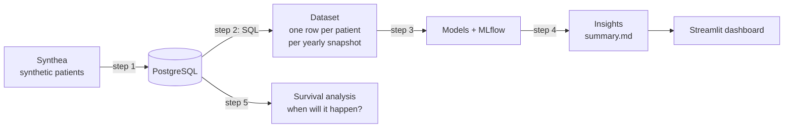
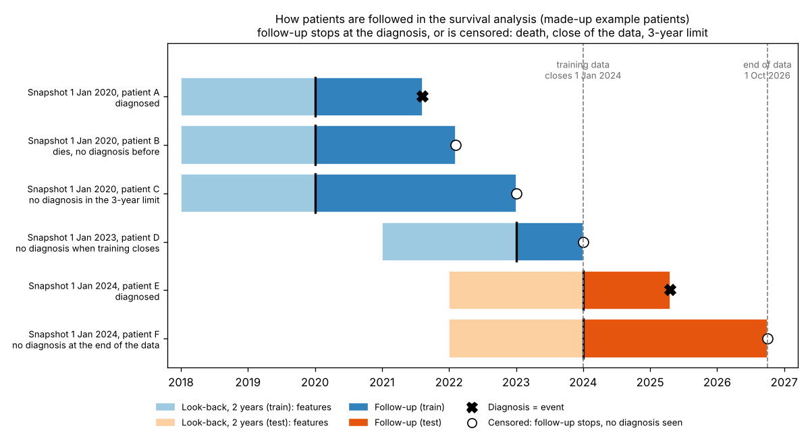
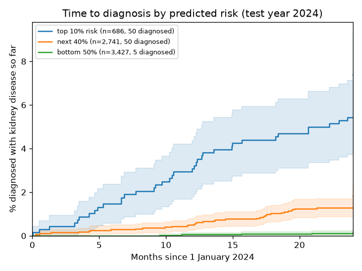
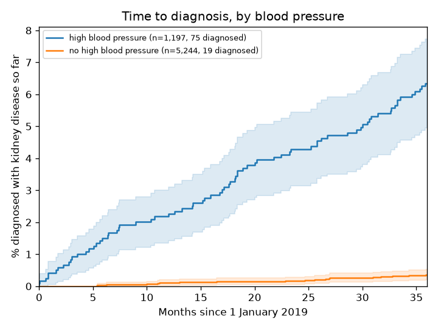
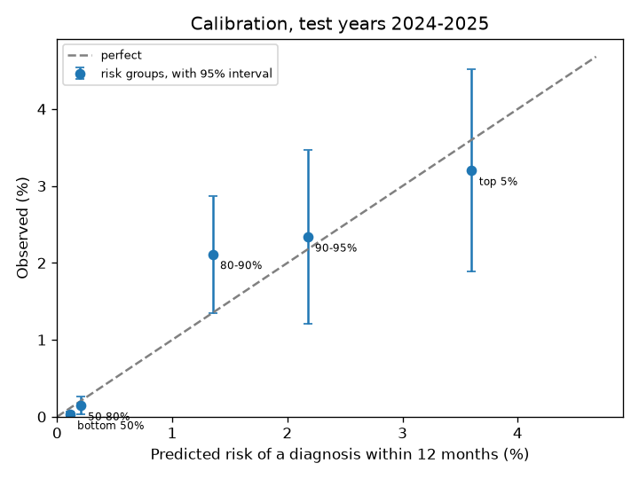

# Patient finding: flagging undiagnosed kidney disease

Can routine health records flag adults who will be **diagnosed with chronic kidney disease in the next
12 months**, so they can be tested and treated earlier?

The data is synthetic, made with [Synthea](https://github.com/synthetichealth/synthea), so no real patients
are involved. It has the same structure as real health records: patients, visits, diagnoses, lab results and medicines.

**Short answer: partly yes.** On synthetic data, a simple model ranks patients well enough to be useful,
but it can't pick out individual patients with high certainty.

- Reviewing the top 10% of patients by risk score finds about half (49%) of next year's kidney
  patients. A random 10% would find about 10%.
- Most of the signal comes from information already in the record: a high blood pressure diagnosis,
  protein in the urine (albumin/creatinine ratio) and blood pressure readings.
- 42% of newly diagnosed patients had an abnormal kidney test a median of 55 months before diagnosis.
  A simple rule ("abnormal test, no diagnosis yet -> follow up") would already catch many of them.
- Precision stays low (about 3% of flagged patients get the diagnosis), so this works for prioritising
  who to test, not as a diagnosis.
- The data is synthetic, so this needs checking on real health records before any real use.


## How it works



| Step | File | What it does |
|---|---|---|
| 1 | `step1_load_data.py` | Loads the Synthea CSV files into PostgreSQL |
| 2 | `step2_build_dataset.py` | Runs `sql/2_cohort.sql` and `sql/3_features.sql` |
| 3 | `step3_train_model.py` | Logistic regression vs gradient boosting, PR-AUC, MLflow |
| 4 | `step4_insights.py` | Diagnostic delay, cases found per review effort, `reports/summary.md` |
| 5 | `step5_survival.py` | Survival analysis: time to diagnosis, Kaplan-Meier curves, risk at 12 and 24 months |
| - | `survival_utils.py` | Helper functions for step 5 (follow-up time, Kaplan-Meier, C-index), no database needed |
| - | `run_all.py` | Steps 1-5 in order |
| - | `dashboard/app.py` | Streamlit dashboard |
| - | `open_mlflow.py` | Opens the MLflow page in the browser |
| - | `make_study_design.py` | Draws the study design picture below |
| - | `make_survival_design.py` | Draws the follow-up picture in the survival section |
| - | `notebooks/explore.ipynb` | First look at the data |
| - | `tests/test_no_leakage.py` | Checks that no future information leaks into the features |
| - | `tests/test_survival.py` | Checks the survival helpers on small made-up examples |

## The set-up


- **Snapshot:** on 1 January of every year 2019-2025, take every adult without kidney disease who had a visit in the previous 2 years.
- **Features:** only data from the 2 years *before* the snapshot (visits, diagnoses, lab results, blood pressure, medicines).
- **Label:** 1 if the patient gets a first kidney disease diagnosis in the 12 months *after* the snapshot.
- **Train on the past, test on the future:** snapshots 2019-2023 for training, 2024-2025 for testing.
- **Rare target (about 0.5%):** accuracy would be useless, so I use **PR-AUC** and "% of future cases found in the top 5%".

## Results

Test years 2024-2025: 13,769 patient snapshots, of which 75 (0.5%) were diagnosed with kidney disease in the next 12 months.

| Model | PR-AUC | ROC-AUC | Found in top 5% |
|---|---|---|---|
| Logistic regression | 0.030 | 0.872 | 27% |
| Gradient boosting | 0.024 | 0.870 | 23% |
| Random guess | 0.005 | 0.5 | 5% |

Logistic regression is about 6x better than random on PR-AUC. Gradient boosting didn't do better,
so I kept the simpler model, which is also easier to explain.

Reviewing the top 10% of patients by risk score finds 37 of the 75 future cases (49%), the top 20% finds 87%.

The strongest signal by far is a high blood pressure diagnosis, followed by the urine albumin/creatinine
ratio, number of medicines and systolic blood pressure.

Patient journey: 42% of newly diagnosed patients (110 of 265) had an abnormal kidney test
(eGFR < 60 or creatinine > 1.3) a median of 55 months before the diagnosis.

Full summary: [reports/summary.md](reports/summary.md)

### Dashboard


Streamlit dashboard (`streamlit run dashboard/app.py`). The slider sets how many patients a team can review;
the numbers and the red line on the curve show how many future cases that finds.
Patients are listed by risk rank instead of raw score, because class weighting pushes the
predicted probabilities too high (the order is still right).

### MLflow


Both models logged in MLflow with parameters, metrics and the trained model, so runs can be compared
and reproduced (`python open_mlflow.py`).

## When will the diagnosis come? Survival analysis (step 5)

The yes/no label only answers "diagnosed within 12 months?". Step 5 asks "how long until the diagnosis?".
Patients who die or whose data ends before a diagnosis are *censored*: we know they were free of the disease
up to that day, nothing more. A yes/no label throws that information away.



- **Same patients, same features, same split** as before. Each snapshot is followed from the snapshot date until diagnosis, death, the 3-year limit or the end of the data.
- **Training rows are cut at 1 Jan 2024**, so training never sees what happens in the test years. Test rows are followed until the end of the data (1 Oct 2026).
- **Model:** discrete-time survival. Each patient gets one row per quarter at risk, a classifier predicts the chance of diagnosis in that quarter, and the survival curve is the product of (1 - chance) over the quarters.
- **Metrics:** PR-AUC and recall at 12 and 24 months, C-index (does the patient who gets diagnosed first have the higher risk?) and a calibration check against Kaplan-Meier.

### Results

| Model (test years 2024-2025) | PR-AUC 12m | ROC-AUC 12m | Found in top 5% | Found in top 10% |
|---|---|---|---|---|
| Step 3 logistic regression (yes/no label) | 0.030 | 0.872 | 27% | 49% |
| Survival, logistic | 0.026 | 0.878 | 29% | 51% |
| Survival, gradient boosting | 0.024 | 0.866 | 25% | 45% |
| Random guess | 0.005 | 0.5 | 5% | 10% |

At 12 months the survival models do about the same as the yes/no model. With 75 cases the differences are
within the noise. What the survival model adds is risk at any horizon from one model. At 24 months (snapshot 2024 only)
the logistic version has ROC-AUC 0.854 and C-index 0.864, and the top 10% holds 47% of the cases.



Test snapshot 1 Jan 2024, split by predicted risk. After 24 months 5.3% of the top 10% are diagnosed, 1.3% of the next 40% and 0.1% of the bottom half. The curves separate clearly.



Training snapshot 1 Jan 2019. After 3 years 6.3% of patients with a high blood pressure diagnosis are diagnosed with kidney disease, against 0.4% of the others.



Calibration at 12 months is close for the top 10% of patients (2.2% predicted vs 2.3% observed at 90-95%, 3.6% vs 3.2% in the top 5%). The 80-90% group is underestimated (1.4% vs 2.1%) and the lowest-risk half is overestimated
(predicted 0.11%, observed 0.03%).

Full numbers: `reports/survival_results.csv` and `reports/survival_calibration.csv`. MLflow experiment: `ckd_survival`.

## How to run

1. `conda env create -f environment.yml` and `conda activate patientfinding`
2. `createdb patientfinding` (set `PF_DB_URL` if your PostgreSQL needs a user and password)
3. Generate the data (15-40 minutes, about 2 GB):
   ```bash
   curl -L -o synthea.jar https://github.com/synthetichealth/synthea/releases/download/v3.4.0/synthea-with-dependencies.jar
   java -jar synthea.jar -p 10000 -s 42 -cs 42 -r 20261001 -e 20261001 \
     --exporter.csv.export true --exporter.fhir.export false \
     --exporter.hospital.fhir.export false --exporter.practitioner.fhir.export false \
     --exporter.csv.included_files patients.csv,encounters.csv,conditions.csv,observations.csv,medications.csv \
     Massachusetts
   ```
4. `python run_all.py` (steps 1-5; `--skip-load` skips step 1)
5. `pytest`
6. `python open_mlflow.py` (MLflow runs) and `streamlit run dashboard/app.py` (dashboard)

## Limitations
- Synthetic data follows rules, so it is cleaner than real records. The method transfers; the numbers do not.
- Few positive cases in the test years, so the metrics are uncertain.
- Death is treated as censoring. A patient who dies can no longer be diagnosed, so risks are a bit high. A competing-risks model would handle this properly.
- The same patient appears in several snapshots, and in both train and test. The confidence intervals ignore this.
- Features are fixed at the snapshot date. They do not update during follow-up.
- Two models, not tuned. Cox models and survival forests are the next thing to try.
